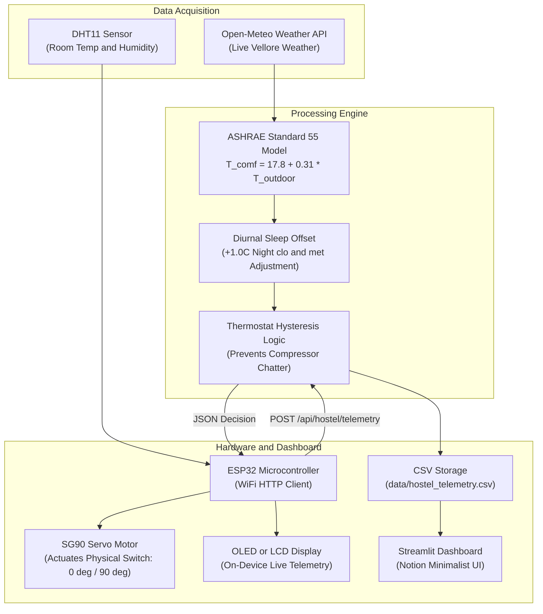

# Adaptive Thermal Comfort AC Controller for Hostels
### BTech First Year Engineering Project | Vellore Campus

> **A closed-loop physical IoT system:**
> An ESP32 microcontroller with a DHT11 sensor monitors hostel room temperatures and mechanically actuates an **SG90 micro servo motor** to flip the physical AC rocker switch ON or OFF based on the **ASHRAE 55 Adaptive Comfort Model**, compensating for nighttime sleep metabolism and blanket insulation.

---

## Getting Started: Start Here!

If you are opening this repository for the first time, do not worry if you have never built an IoT device or worked with backend servers before. Everything in this project has been built using **simple, beginner-friendly Python** (only basic functions, dictionaries, and lists — zero complex classes or OOP).

Follow this 3-step guide to get up to speed in 15 minutes:

### Step 1: Read the Plain-English Walkthrough (10 Minutes)
Open [**docs/TEAM_WALKTHROUGH.md**](docs/TEAM_WALKTHROUGH.md).  
Written like an experienced engineer explaining things to a beginner, it walks you through:
* The real physical problem: hostel rooms freezing down to 19°C overnight because wall switches lack thermostats.
* Why we do not tackle classrooms (knowing what not to measure when you lack sensors).
* What every single file in the project does and why libraries like `requests` and `flask` are imported.
* What ASHRAE means and why we use it.
* Exact review speaking scripts for each part of the project.

### Step 2: Practice with Your 1-on-1 AI Tutor (5 Minutes)
Open [**docs/AI_ONBOARDING_PROMPT.md**](docs/AI_ONBOARDING_PROMPT.md).  
Copy that entire text and paste it into ChatGPT, Claude, or Gemini. The prompt instructs the AI to:
* Act like a patient mentor who assumes you know nothing about programming.
* Explain any specific file to you line by line.
* Conduct a friendly mock viva review with 3 to 5 realistic questions.

### Step 3: Review Expected Viva Questions
Open [**docs/PROJECT_VIVA_QA.md**](docs/PROJECT_VIVA_QA.md).  
Contains answers and diagrams for 13 common questions professors ask (hysteresis, sleep metabolism, SG90 servo safety, offline failsafe, and syllabus mapping).

---

## Subsystems & Architecture Overview

The system is organized into modular subsystems with clean separation of responsibilities:

| Subsystem / Area | Primary Files | Key Concepts & Architecture |
| :--- | :--- | :--- |
| **Comfort Model & Decision Logic** | [`comfort_model.py`](comfort_model.py) | **ASHRAE Standard 55 & Decision Logic:** Linear formula `17.8 + 0.31 * outdoor`, +1.0°C night sleep offset for blankets, and thermostat hysteresis deadband to prevent switch chatter. |
| **Weather Pipeline** | [`weather_service.py`](weather_service.py) | **Live Meteorological Pipeline:** Open-Meteo REST API data fetching for Vellore coordinates, 5-minute memory cache to prevent API spamming, and `try...except` offline fallback. |
| **Run-Time Analytics** | [`comfort_model.py`](comfort_model.py), [`dashboard.py`](dashboard.py) | **Cooling Run-Time Reduction:** Directly measured temperature dynamics cutting active cooling time by ~50% overnight, preventing 16 degree-hours of overcooling without guessing chiller tonnage. |
| **Dashboard & Web API** | [`dashboard.py`](dashboard.py), [`app.py`](app.py) | **Presentation & Communication:** Streamlit Notion-style web dashboard, resident preference slider, and Flask REST API endpoints serving JSON decisions to the ESP32. |
| **Hardware & Firmware** | [`hardware/`](hardware/) | **Embedded IoT Actuation:** ESP32 DevKit C++ firmware, DHT11 sensing on GPIO 4, and SG90 servo motor flipping the physical rocker switch safely without mains rewiring. |
| **Data Persistence & Testing** | [`storage.py`](storage.py), [`test_system.py`](test_system.py) | **Storage & Quality Assurance:** CSV telemetry logging using `with open`, automated 7-step unit tests, and ESP32 offline failsafe. |

---

## 1. Project Overview & Problem Statement

* **The Problem:** Campus hostel AC units have only a binary on/off rocker switch on the wall — **no thermostat and no remote control**. Left running overnight, rooms plunge below 19°C, causing broken sleep, shivering under blankets, and massive wasted electricity.
* **Why Hostels (Not Classrooms):** Academic buildings use centralized chillers where calculating energy requires knowing chiller tonnage (TR), power ratings, airflow CFM, and student headcounts — none of which are instrumented. In contrast, hostel rooms have individual wall switches right in front of us, where our ESP32 device directly solves a real physical problem.
* **Our Solution:** An affordable IoT retrofit (**₹813 BOM**) with an ESP32 microcontroller, a DHT11 temperature sensor, and an SG90 micro servo motor. The system calculates real-time comfort using ASHRAE Standard 55 with nighttime sleep compensation, and mechanically toggles the wall switch ON or OFF while reporting live telemetry to a Notion-style web dashboard.

---

## 2. System Architecture



---

## 3. Quick Start (Run on Your Laptop in 60 Seconds)

### Step 1: Install Required Packages
Open PowerShell or Command Prompt in this folder and run:
```bash
py -m pip install -r requirements.txt
```

### Step 2: Verify the Code (Automated Tests)
Run the 7-step automated test suite to confirm everything works:
```bash
py test_system.py
```
*(All 7 tests should complete in under 1 second with `OK`.)*

### Step 3: Launch the Full System (1-Click)
```bash
py run_system.py
```
* **Web Dashboard:** [http://localhost:8501](http://localhost:8501)
* **Flask REST API:** [http://127.0.0.1:5000](http://127.0.0.1:5000)

### Testing Without Hardware:
In the dashboard sidebar:
1. Adjust the **"Your Preferred Temperature"** slider.
2. Use the **"Test Sensor Simulator"** slider to test room temperatures from 18°C to 30°C.
3. Click **"Send Reading to Model"** to watch the AC switch state and servo angle flip live on screen!

---

## 4. Hardware Setup (BOM: ₹813)

### Bill of Materials
| Component | Function | Approx Price (₹) |
| :--- | :--- | :--- |
| **ESP32 Dev Board** | WiFi microcontroller & HTTP client | 400 |
| **SG90 Servo Motor** | Physical switch actuator (0° OFF / 90° ON) | 150 |
| **0.96" I2C OLED (SSD1306) / 16x2 LCD** | On-device temperature & state display | 212 |
| **DHT11 Sensor** | Room temperature & humidity sensing | 51 |
| **Total** | | **₹813** |

### Pinout Connections
* **DHT11 Data Pin:** Connect to `GPIO 4` (VCC to `3V3`, GND to `GND`)
* **SG90 Servo Signal:** Connect to `GPIO 18` (VCC to `VIN 5V`, GND to `GND`)
* **I2C Display (OLED / LCD):**
  - `SDA` -> `GPIO 21`
  - `SCL` -> `GPIO 22`
  - `VCC` -> `3V3` (for OLED) or `5V` (for 16x2 LCD)
  - `GND` -> `GND`

---

## 5. Thermal Comfort Science (ASHRAE Standard 55)

The adaptive comfort model establishes that human thermal comfort naturally shifts with outdoor temperatures:

$$T_{\text{comf}} = 17.8 + 0.31 \times T_{\text{outdoor}}$$

* **80% Acceptability Limits:** $T_{\text{comf}} \pm 1.75^\circ\text{C}$
* **Nighttime Sleep Compensation:**
  - Awake metabolic rate ($M \approx 1.0\text{ met}$) vs. sleeping metabolic rate ($M \approx 0.7\text{ met}$).
  - Daytime clothing ($I_{cl} \approx 0.5\text{ clo}$) vs. blankets/sleepwear ($I_{cl} \approx 1.2 - 1.5\text{ clo}$).
  - Lower basal heat production + higher blanket insulation shifts the comfortable setpoint up by **+1.0°C**, preventing shivering or disturbed sleep.
* **Hysteresis Deadband:**
  - Once room temperature cools to the lower limit, the AC is switched OFF (0°).
  - The AC only turns back ON (90°) when the room warms up to the upper comfort threshold.
  - Between the two thresholds, the AC stays in its previous state, preventing compressor chatter.

---

## 6. Academic Syllabus Mapping (First-Year Python)

| Syllabus Requirement | Project Implementation |
| :--- | :--- |
| **Functions & Modular Design** | Pure functions in `weather_service.py`, `comfort_model.py`, `storage.py` |
| **Conditionals (if/elif/else)** | Thermostat hysteresis decision branching and night-time mode detection |
| **Lists, Dictionaries & Tuples** | State dictionaries, comfort range dicts, `(state, angle, reason)` tuples |
| **File Handling (CSV)** | `storage.py` reading/writing `hostel_telemetry.csv` using `with open` |
| **Exception Handling** | `try...except` handling API network drops with offline fallback |
| **Networking & APIs** | `requests` querying Open-Meteo; Flask serving REST endpoints for ESP32 |
| **Data Visualization** | Interactive Plotly time-series comfort bands & Streamlit Notion UI |
