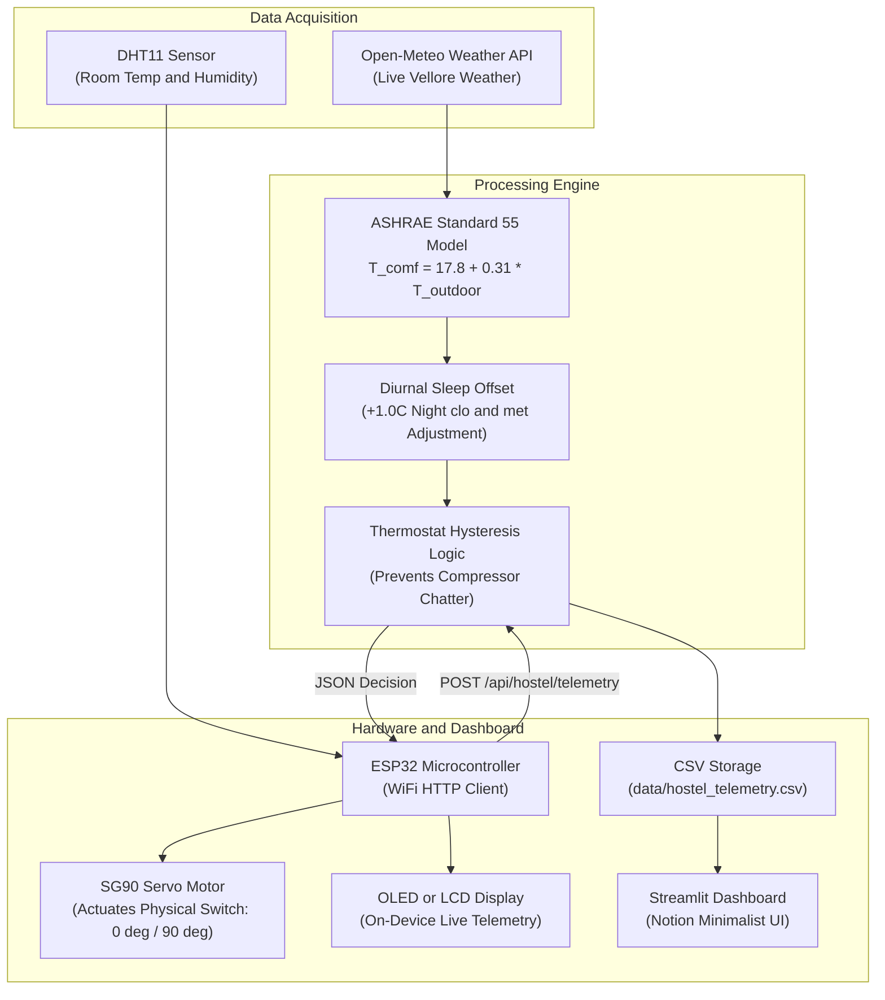

# Adaptive Thermal Comfort AC Controller for Hostels
### BTech First Year Engineering Project | Vellore Campus

> **A closed-loop physical IoT system:**
> An ESP32 microcontroller with a DHT11 sensor monitors hostel room temperatures and mechanically actuates an **SG90 micro servo motor** to flip the physical AC rocker switch ON or OFF based on the **ASHRAE 55 Adaptive Comfort Model**, compensating for nighttime sleep metabolism and blanket insulation.

> **Helpful Guides for the Team:**
> * [**Team Walkthrough & Beginner Guide (`TEAM_WALKTHROUGH.md`)**](TEAM_WALKTHROUGH.md): Beginner-friendly explanation of every file, import, and role cheat sheets.
> * [**AI Onboarding Prompt (`AI_ONBOARDING_PROMPT.md`)**](AI_ONBOARDING_PROMPT.md): Copy-paste prompt to have Claude/ChatGPT tutor any teammate one-on-one.
> * [**Review & Viva Q&A Guide (`PROJECT_VIVA_QA.md`)**](PROJECT_VIVA_QA.md): Anticipated examiner questions, diagrams, and formula breakdowns.

---

## 1. Project Overview & Problem Statement

* **The Problem:** Most campus hostel AC units have binary on/off rocker switches with **zero thermostat and no remote control**. Left running overnight, rooms become uncomfortably cold (~19°C), causing sleep disruption, shivering under blankets, and massive wasted electricity.
* **Why Focus Exclusively on Hostels (Not Classrooms):** Centralized campus classrooms use massive commercial chillers where accurate energy calculations require knowing chiller tonnage (TR), power ratings, airflow CFM, and real-time occupant counts — none of which are instrumented. In contrast, hostel rooms have decentralized binary AC units where a physical ESP32 retrofit directly solves a real overnight overcooling problem with verifiable physical hardware.
* **Our Solution:** A lightweight Python system that fetches live outdoor weather for the Vellore campus, calculates real-time adaptive comfort thresholds with nighttime sleep compensation, and directly controls the physical AC switch via an ESP32 unit, while displaying live status and overnight cooling run-time reduction on a Notion-style web dashboard.

---

## 2. System Architecture



---

## 3. Quick Start (Run in 60 Seconds)

### Prerequisites
- Python 3.10+ (tested on Python 3.13)
- Required packages:
  ```bash
  py -m pip install -r requirements.txt
  ```

### Option A: Run Full System (Flask API + Notion Dashboard)
```bash
py run_system.py
```
- **Web Dashboard:** [http://localhost:8501](http://localhost:8501)
- **Flask REST API:** [http://127.0.0.1:5000](http://127.0.0.1:5000)

### Option B: Run Dashboard Only
```bash
py run_system.py --dashboard-only
```
*(The dashboard has a built-in sensor simulator in the sidebar to test decisions without running the Flask server!)*

### Option C: Run Hardware Simulator (Demo Without ESP32)
In a separate terminal, test the automated room heating/cooling cycle:
```bash
py simulate_esp32.py
```
Or run in interactive mode to test custom temperatures:
```bash
py simulate_esp32.py --interactive
```

---

## 4. Hardware Unit Setup (BOM: ₹813)

### Bill of Materials
| Component | Function | Approx Price (₹) |
| :--- | :--- | :--- |
| **ESP32 Dev Board** | WiFi microcontroller & HTTP client | 400 |
| **SG90 Servo Motor** | Physical switch actuator (0° OFF / 90° ON) | 150 |
| **0.96" I2C OLED (SSD1306) / 16x2 LCD** | On-device temperature & state display | 212 |
| **DHT11 Sensor** | Room temperature & humidity sensing | 51 |
| **Total** | | **₹813** |

### Pinout Wiring Table
* **DHT11 Data Pin:** Connect to `GPIO 4` (VCC to `3V3`, GND to `GND`)
* **SG90 Servo Signal:** Connect to `GPIO 18` (VCC to `VIN 5V`, GND to `GND`)
* **I2C Display (OLED / LCD):**
  - `SDA` -> `GPIO 21`
  - `SCL` -> `GPIO 22`
  - `VCC` -> `3V3` (for OLED) or `5V` (for 16x2 LCD)
  - `GND` -> `GND`

### Flashing the ESP32
1. Open Arduino IDE.
2. Install required libraries from Library Manager:
   - `DHT sensor library` (Adafruit)
   - `ESP32Servo` (Kevin Harrington)
   - `ArduinoJson` (Benoit Blanchon)
   - `Adafruit SSD1306` & `Adafruit GFX` (if using OLED)
3. Open `hardware/hostel_ac_controller/hostel_ac_controller.ino`.
4. Update `WIFI_SSID`, `WIFI_PASSWORD`, and your laptop's local IP in `SERVER_URL`.
5. Select Board **ESP32 Dev Module** and click **Upload**.

---

## 5. Thermal Comfort Science (ASHRAE Standard 55)

The adaptive comfort model establishes that human thermal comfort naturally shifts with outdoor temperatures:

$$T_{\text{comf}} = 17.8 + 0.31 \times T_{\text{outdoor}}$$

* **80% Acceptability Limits:** $T_{\text{comf}} \pm 1.75^\circ\text{C}$
* **Nighttime Sleep Compensation:**
  - Awake metabolic rate ($M \approx 1.0\text{ met}$) vs. sleeping metabolic rate ($M \approx 0.7\text{ met}$).
  - Daytime clothing ($I_{cl} \approx 0.5\text{ clo}$) vs. blankets/sleepwear ($I_{cl} \approx 1.2 - 1.5\text{ clo}$).
  - Lower basal heat production + higher blanket insulation shifts the comfortable setpoint up by **+1.0°C**, preventing shivering or disturbed sleep.
* **Hysteresis Deadband:**
  - Once room temperature cools to the lower limit, AC is switched OFF.
  - The AC only turns back ON when the room warms up to the upper comfort threshold.
  - This prevents compressor cycling and switch wear.

---

## 6. Academic Syllabus Mapping (First-Year Python)

| Syllabus Requirement | Project Implementation |
| :--- | :--- |
| **Functions & Modular Design** | Pure functions in `weather_service.py`, `comfort_model.py`, `storage.py` |
| **Conditionals (if/elif/else)** | Thermostat hysteresis decision branching and night-time mode detection |
| **Lists, Dictionaries & Tuples** | State dictionaries, comfort range dicts, `(state, angle, reason)` tuples |
| **File Handling (CSV)** | `storage.py` reading/writing `hostel_telemetry.csv` using `with open` |
| **Exception Handling** | `try...except` handling API network drops with offline fallback |
| **Networking & APIs** | `requests` querying Open-Meteo; Flask serving REST endpoints for ESP32 |
| **Data Visualization** | Interactive Plotly time-series comfort bands & Streamlit Notion UI |

---

## 7. Team Division of Work

| Team Member | Core Responsibility |
| :--- | :--- |
| **Jalak Vijay Hadvani (Coordinator)** | ASHRAE Adaptive Comfort Model implementation; overall integration |
| **Priyamvadha H L** | Weather API integration and outdoor meteorological data pipeline |
| **Itla Naveen Shiv Shankar** | Nocturnal thermal dynamics & overnight energy savings analysis |
| **Maneet Singh** | Dashboard (Streamlit/Plotly), ESP32 firmware, sensor & servo hardware integration |
| **Smyan Ojha** | Testing, edge-case handling, documentation and presentation |
