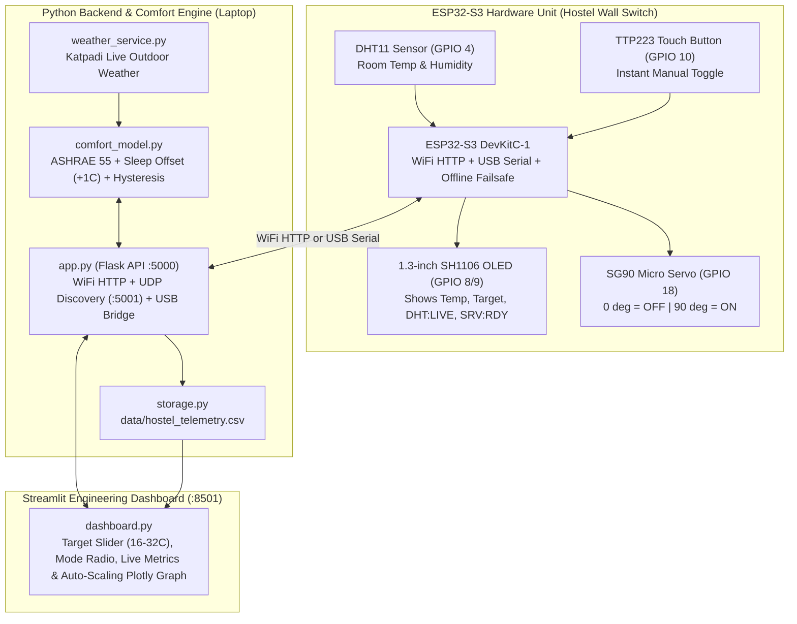

# Adaptive Thermal Comfort AC Controller for Hostels
### Closed-Loop IoT Switch Actuation & ASHRAE Standard 55 Control System

> **What this project does in one sentence:**  
> An **ESP32-S3 microcontroller** reads room temperature & humidity from a **DHT11 sensor (`GPIO 4`)**, talks to a Python backend running the **ASHRAE Standard 55 Adaptive Comfort Model** (with overnight sleep compensation), and physically flips the hostel AC wall switch **ON (`90°`)** or **OFF (`0°`)** using an **SG90 micro servo motor (`GPIO 18`)**.

---

## Teammates: Start Here! (15-Minute Prep Guide)

If you are opening this repository before tomorrow's review, **don't panic!** The entire Python codebase has been stripped down to **simple, beginner-friendly functions and dictionaries** (zero classes, zero OOP, zero complicated HTML/CSS).

Follow these 3 steps to get ready in 15 minutes:

1. **Read the Plain-English Walkthrough (8 mins):**  
   Open [**docs/TEAM_WALKTHROUGH.md**](docs/TEAM_WALKTHROUGH.md). It explains the real-world problem, why we focus on hostel switches instead of classrooms, what every single Python file and hardware pin does in plain English, and gives you exact **word-for-word speaking scripts** for the viva.
2. **Practice with Your 1-on-1 AI Mentor (5 mins):**  
   Open [**docs/AI_ONBOARDING_PROMPT.md**](docs/AI_ONBOARDING_PROMPT.md). Copy and paste that prompt into ChatGPT, Claude, or Gemini — it will act as a friendly tutor, explain your part of the code line-by-line, and quiz you with 3 easy mock viva questions.
3. **Skim the Examiner Q&A Sheet (2 mins):**  
   Open [**docs/PROJECT_VIVA_QA.md**](docs/PROJECT_VIVA_QA.md) for quick answers to the 13 most common professor questions.

---

## 1. Repository File Map (What Every File Does)

The entire Python backend and dashboard is just **6 short files**:

| File | Lines | What It Does (Plain English) |
| :--- | :---: | :--- |
| [`config.py`](config.py) | ~38 | Stores constants in one place: Katpadi campus coordinates (`12.9692°N, 79.1559°E`), ASHRAE formula numbers (`17.8`, `0.31`), night sleep offset (`+1.0°C`), servo angles (`0°` OFF, `90°` ON), and the CSV file path. |
| [`weather_service.py`](weather_service.py) | ~68 | Fetches live outdoor temperature & humidity for **Katpadi, Vellore** using `requests.get()` (with a 5-minute memory cache and `try...except` offline backup so it never crashes). |
| [`comfort_model.py`](comfort_model.py) | ~98 | **The Mathematical Brain:** Calculates the ASHRAE 55 comfort temperature ($T_{\text{comf}} = 17.8 + 0.31 \times T_{\text{outdoor}}$), adds $+1.0^\circ\text{C}$ at night (10 PM – 7 AM) for blankets & lower sleep metabolism, and uses **hysteresis ($\pm 1.5^\circ\text{C}$ deadband)** to decide if the AC switch should be `ON (90°)` or `OFF (0°)`. |
| [`storage.py`](storage.py) | ~74 | Saves every sensor reading and AC decision into `data/hostel_telemetry.csv` using Python's `with open(...)` context manager, and reads it back with `pandas` for the graph. |
| [`app.py`](app.py) | ~260 | **The Flask Server (Port 5000):** Receives live readings from the ESP32 over WiFi HTTP (`POST /api/hostel/telemetry`) or USB Serial, runs `comfort_model.py`, saves to CSV, and tells the ESP32 whether to move the servo to `0°` or `90°`. Also responds to UDP broadcast on port `5001` so the ESP32 finds the laptop IP automatically. |
| [`dashboard.py`](dashboard.py) | ~315 | **The Live Web Dashboard (Port 8501):** Built with pure native Streamlit components (`st.metric`, `st.slider`, `st.radio`, `st.tabs`, `st.plotly_chart`). Shows live DHT11 temperature/humidity, AC state, servo angle, target setpoint (`16°C–32°C`), and an auto-scaling temperature vs. comfort band graph. |
| [`run_system.py`](run_system.py) | ~56 | **One-Click Launcher:** Starts both `app.py` (Flask) and `dashboard.py` (Streamlit) at the same time with one command (`py run_system.py`). |
| [`hardware/hostel_ac_controller/hostel_ac_controller.ino`](hardware/hostel_ac_controller/hostel_ac_controller.ino) | C++ | **ESP32-S3 Firmware:** Reads the DHT11 (`GPIO 4`) and Capacitive Touch button (`GPIO 10`), updates the 1.3" SH1106 OLED (`SDA=8, SCL=9`), sends readings to the laptop, and drives the SG90 servo (`GPIO 18`). Includes an offline failsafe if WiFi disconnects. |

---

## 2. System Architecture Diagram



---

## 3. Hardware Pinout (ESP32-S3 DevKitC-1, Total BOM: ₹813)

| Component | ESP32-S3 Pin | Power & Wiring Notes | Cost (₹) |
| :--- | :--- | :--- | :---: |
| **ESP32-S3 DevKitC-1 N16R8** | USB-C (`COM12`) | Powered via USB cable connected to laptop | 400 |
| **DHT11 Temperature & Humidity Sensor** | `GPIO 4` (Data) | `VCC` $\rightarrow$ `3V3`, `GND` $\rightarrow$ `GND` | 51 |
| **TTP223 Capacitive Touch Button** | `GPIO 10` (`I/O`) | `VCC` $\rightarrow$ `3V3`, `GND` $\rightarrow$ `GND` (toggles servo `0°`/`90°` on touch) | *(incl.)* |
| **1.3" SH1106 I2C OLED Display** | `SDA = GPIO 8`, `SCL = GPIO 9` | `VCC` $\rightarrow$ `3V3`, `GND` $\rightarrow$ `GND` (I2C address `0x3C`) | 212 |
| **SG90 Micro Servo Motor** | `GPIO 18` (PWM Signal) | Power `VCC` (`+5V`) from external 5V adapter; **connect external adapter `GND` and ESP32 `GND` together** (common ground) | 150 |
| **Total Prototype Cost** | | | **₹813** |

---

## 4. How to Run the Project (In 30 Seconds)

### Step 1: Install Python Dependencies
```bash
py -m pip install -r requirements.txt
```

### Step 2: Start Both the Backend Server & Live Dashboard
```bash
py run_system.py
```
* **Live Dashboard:** [http://localhost:8501](http://localhost:8501)
* **Flask REST API:** [http://127.0.0.1:5000](http://127.0.0.1:5000)

*(If your ESP32-S3 is plugged into USB or connected to the mobile hotspot `eeeeee` / password `vv202526`, it will automatically stream live DHT11 readings into the dashboard every 2.5 seconds!)*
