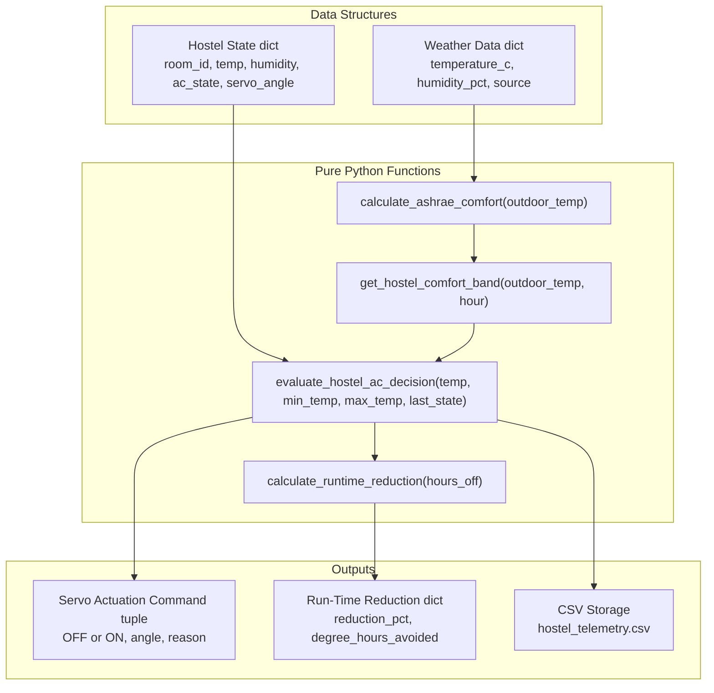
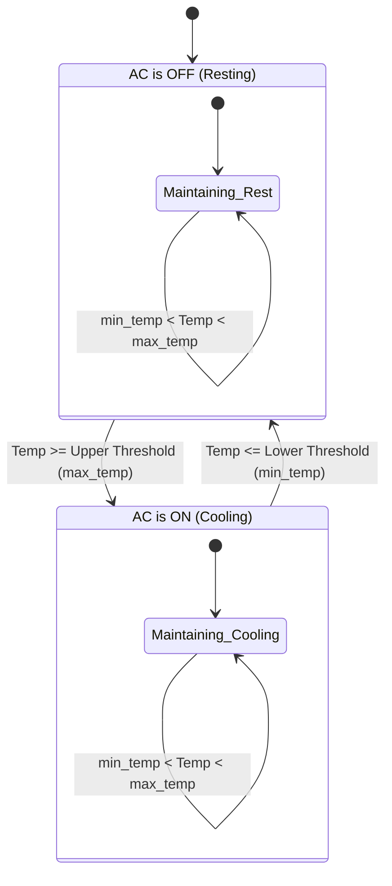
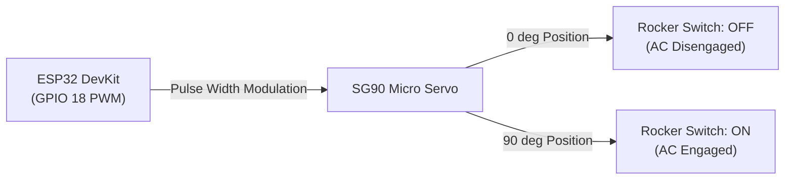

# Project Review & Viva Q&A Guide
### Adaptive Thermal Comfort AC Controller for Campus Hostels
**Course:** BTech First Year Engineering Project

---

## Table of Contents
1. [Software Architecture & Syllabus-Aligned Design](#1-software-architecture--syllabus-aligned-design)
2. [Scope Justification: Why Hostels Over Classrooms?](#2-scope-justification-why-hostels-over-classrooms)
3. [Thermal Physics & ASHRAE Standard 55](#3-thermal-physics--ashrae-standard-55)
4. [Control Systems & Hysteresis Logic](#4-control-systems--hysteresis-logic)
5. [Hardware, ESP32 & IoT Engineering](#5-hardware-esp32--iot-engineering)
6. [Python Syllabus & Concepts Mapping](#6-python-syllabus--concepts-mapping)
7. [Edge Cases, Limitations & Future Scope](#7-edge-cases-limitations--future-scope)

---

## 1. Software Architecture & Syllabus-Aligned Design

### Q1. Why did you use Functions, Dictionaries, and Lists instead of complex Object-Oriented Programming (OOP)?

#### 🎯 Answer:
In a First-Year Python curriculum, the academic objective is mastering fundamental computational concepts:
* **Pure Functions** (`def`) for modular, reusable algorithms.
* **Dictionaries** (`{}`) and **Lists** (`[]`) for structured data storage (matching JSON API payloads).
* **Tuples** (`()`) for immutable multi-value returns like `(ac_state, servo_angle, reason)`.

Forcing complex class hierarchies with `__init__`, `super()`, and inheritance adds unnecessary boilerplate when Python's built-in dictionaries represent real-world entities much more cleanly and transparently.



---

### Q2. Why did you use Flask and Streamlit together instead of just one?

#### 🎯 Answer:
This is a standard **Separation of Concerns (SoC)** architectural pattern:
1. **Flask (Headless REST API Backend):**
   - Microcontrollers like the ESP32 require ultra-fast, lightweight JSON endpoints (`POST /api/hostel/telemetry`).
   - Flask processes HTTP requests in milliseconds without rendering UI overhead.
2. **Streamlit (Presentation & Monitoring Dashboard):**
   - Streamlit provides a clean, responsive Notion-style interface for users to monitor room telemetry.
   - It visualizes Plotly interactive charts and lets users test temperature decisions using sliders without altering the embedded firmware code.

---

## 2. Scope Justification: Why Hostels Over Classrooms?

### Q3. Why did you focus exclusively on hostel ACs instead of campus classrooms? (EXAMINER FAVORITE)

#### 🎯 Answer:
This was a deliberate and realistic engineering design decision based on physical and technical feasibility:

1. **Centralized HVAC Complexity (Tonnage & Occupancy):**
   - Classrooms are cooled by massive centralized chillers. Calculating real cooling load and energy waste requires knowing compressor tonnage (TR), sensible heat ratio, airflow CFM, solar radiation through windows, and exact real-time student headcounts.
   - Without high-end industrial flow meters and optical sensors, classroom modeling is purely theoretical and speculative.
2. **Decentralized Binary Control:**
   - Hostel rooms have individual split/window AC units with simple on/off rocker switches.
   - Because they lack thermostats, hostel ACs run continuously at fixed cooling all night, making room temperatures plunge to 19°C.
3. **Actionable Closed-Loop Retrofit:**
   - In hostels, an affordable ESP32 + SG90 servo motor (**₹813 BOM**) directly closes the loop by physically toggling the switch without tampering with 230V mains wiring.
   - It turns the mathematical comfort model into a **tangible physical outcome** rather than an advisory data point on a screen.

---

## 3. Thermal Physics & ASHRAE Standard 55

### Q4. What is ASHRAE, and why are we using the Standard 55 Adaptive Comfort Model instead of a fixed 24°C?

#### 🎯 Answer:
1. **What Does ASHRAE Stand For?**
   - **ASHRAE** stands for the **American Society of Heating, Refrigerating and Air-Conditioning Engineers**.
   - Founded in 1894, it is the premier international scientific organization that establishes the global engineering standards for building HVAC, ventilation, and indoor air quality.

2. **What is ASHRAE Standard 55?**
   - Standard 55 is their globally adopted benchmark titled *"Thermal Environmental Conditions for Human Occupancy"*.
   - Rather than treating human beings like machines that need an unchanging 22°C or 24°C year-round, Standard 55 defines the **Adaptive Comfort Model**.

3. **Why Not Just Use a Static 22°C or 24°C?**
   - **Acclimatization:** In hot, tropical climates (where outdoor summer temperatures reach 34°C–38°C), the human body naturally acclimates to warmth through physiological changes (vasodilation, sweating thresholds, and lighter clothing).
   - **Thermal Shock:** Walking from a 35°C outdoor environment into a static 20°C–22°C room causes thermal discomfort, respiratory irritation, and hypothermic shivering. In that climate, a room at 26°C–27°C feels perfectly refreshing and comfortable!
   - **Eliminates Subjective Guesswork:** Instead of roommates arguing over arbitrary numbers, referencing an international standard gives the system objective, scientifically validated authority.

4. **The Linear Regression Formula:**
   Based on empirical field studies across thousands of occupants worldwide, the adaptive comfort equation is:

   $$T_{\text{comf}} = 17.8 + 0.31 \times T_{\text{outdoor}}$$

   * $T_{\text{comf}}$: Optimal indoor operative comfort temperature (°C).
   * $T_{\text{outdoor}}$: Prevailing mean outdoor air temperature (°C), fetched live for the campus location via Open-Meteo.
   * **80% Acceptability Limits:** $T_{\text{comf}} \pm 1.75^\circ\text{C}$ (Standard campus design tolerance).

| Outdoor Temp (°C) | Optimal Comfort $T_{\text{comf}}$ (°C) | 80% Acceptable Band (°C) |
| :---: | :---: | :---: |
| 15.0°C | 22.4°C | 20.7°C – 24.2°C |
| 20.0°C | 24.0°C | 22.2°C – 25.8°C |
| 25.0°C | 25.5°C | 23.8°C – 27.3°C |
| 30.0°C | 27.1°C | 25.3°C – 28.8°C |
| 35.0°C | 28.6°C | 26.9°C – 30.4°C |
| 40.0°C | 30.2°C | 28.4°C – 32.0°C |

---

### Q5. Why is the recommended temperature higher in a hostel room at night?

#### 🎯 Answer:
During the night (22:00 to 07:00), human thermoregulation changes significantly:
1. **Lower Metabolic Heat Production ($M$):** Drops from $\approx 1.0\text{ met}$ (awake) to $\approx 0.7\text{ met}$ (basal metabolic rate during sleep). The body generates 30% less internal heat.
2. **Higher Clothing/Bedding Insulation ($I_{cl}$):** Increases from $0.5\text{ clo}$ (shorts/t-shirt) to $1.2 - 1.5\text{ clo}$ (sleepwear plus blankets/quilts).
3. **The Problem:** When hostel ACs run unmonitored at fixed cooling, the room drops to 19°C – 21°C. Residents wake up shivering and have to pull extra blankets over themselves.
4. **Our Solution:** The function `get_hostel_comfort_band()` adds a **+1.0°C diurnal offset** during night hours, shifting the comfort threshold to $\approx 26.0^\circ\text{C} - 27.0^\circ\text{C}$. Once the room cools below this limit, the AC is automatically switched off.

---

### Q6. How do you evaluate performance when the hostel AC is centralized and you don't know the chiller electrical specs?

#### 🎯 Answer:
Because our hostel cooling is supplied by a centralized campus system, residents do not have access to backend chiller tonnage (TR), power ratings (kW), or compressor COP. Guessing electrical wattage without instruments would be speculative and bad engineering!

Instead, our system evaluates performance based on **direct physical measurements (temperature and time)**:
1. **Active Cooling Run-Time Reduction (%):**
   $$\text{Run-Time Reduction \%} = \left(\frac{\text{Hours Switched OFF}}{\text{Total Sleep Hours (8.0)}}\right) \times 100\%$$
   Turning the local room switch off for 4 hours cuts active cooling delivery by **50%**.
2. **Overcooling Degree-Hours Avoided ($^\circ\text{C}\cdot\text{hr}$):**
   Quantifies the cumulative thermal chilling avoided. If unregulated cooling would drop the room to 19°C (5°C below the 24°C comfort limit) for 4 hours:
   $$\text{Degree-Hours Prevented} = 4\text{ hours} \times 4.0^\circ\text{C} = 16.0^\circ\text{C}\cdot\text{hr}$$
3. **Thermal Comfort Adherence Rate:**
   Measures the percentage of sleep hours maintained strictly inside the ASHRAE Standard 55 comfort band (typically improving from ~40% unmonitored to **>90%** automated).

---

### Q7. How does the system handle individual resident preferences?

#### 🎯 Answer:
In real life, thermal comfort is subjective — some residents feel warm easily while others feel chilly.
Our system allows the resident to dial in their **Preferred Room Target Temperature** on the dashboard sidebar (e.g., 24.5°C):
* **Default Setting:** Automatically defaults to the scientific ASHRAE adaptive weather target (~25.0°C).
* **Tolerance Deadband:** The system centers a $\pm 1.5^\circ\text{C}$ deadband around the resident's preference (e.g. $[23.0^\circ\text{C} - 26.0^\circ\text{C}]$).
* **Overnight Preservation:** Even with a custom preference, the system still automatically applies the biological $+1.0^\circ\text{C}$ sleep offset during night hours (22:00 to 07:00) to account for sleepwear and blankets.

---

## 4. Control Systems & Hysteresis Logic

### Q8. What is Hysteresis (Deadband), and why is it needed for an AC switch?

#### 🎯 Answer:
Without hysteresis, if the target temperature is $26.0^\circ\text{C}$, the system would rapidly cycle:
* Temp reaches $26.1^\circ\text{C}$ $\rightarrow$ AC switches ON.
* Temp cools to $25.9^\circ\text{C}$ in 30 seconds $\rightarrow$ AC switches OFF.
* Temp rises to $26.1^\circ\text{C}$ in 1 minute $\rightarrow$ AC switches ON again.

This phenomenon is called **compressor hunting / chatter**, which burns out relay switches and damages compressor motors.

#### 🔄 Hysteresis State Transition:

* **Upper Cutoff ($T_{\text{max}}$):** When room warms up to $T_{\text{max}}$, AC turns ON (Servo to 90°).
* **Lower Cutoff ($T_{\text{min}}$):** Once room cools down to $T_{\text{min}}$, AC turns OFF (Servo to 0°).
* **Deadband $[T_{\text{min}}, T_{\text{max}}]$:** If the room is anywhere between these two values, the system **maintains its previous state**, ensuring mechanical stability.

---

## 5. Hardware, ESP32 & IoT Engineering

### Q9. Why use an SG90 Servo motor to flip the switch instead of an internal relay?

#### 🎯 Answer:
1. **Zero High-Voltage AC Tampering (Safety):** Hostels and rented rooms strictly prohibit splicing or rewiring 230V mains switchboards. Relays carry electrical shock and fire hazards for student prototypes.
2. **Non-Invasive Universal Retrofit:** An SG90 servo mounts externally on the existing switch plate using adhesive tape or a 3D-printed bracket. It mechanically pushes the physical rocker switch just like a human finger.
3. **Reversibility:** When moving out or in emergencies, the servo unit can be unclipped without leaving any damage or wiring trace.



---

### Q10. What happens if WiFi drops or the backend laptop crashes while residents are asleep?

#### 🎯 Answer:
The ESP32 firmware contains an **Autonomous Local Failsafe**:
```cpp
void executeOfflineFailsafe(float temp) {
  if (temp <= 24.0 && currentAcState == "ON") {
    setAcSwitch(ANGLE_OFF, "OFF"); // Shuts off if room becomes too cold
  } else if (temp >= 26.5 && currentAcState == "OFF") {
    setAcSwitch(ANGLE_ON, "ON");  // Restores cooling if room gets warm
  }
}
```
* If HTTP requests return an error or WiFi is disconnected, the ESP32 logs `[OFFLINE AUTO]` to the on-device display and enforces hardcoded safety thresholds ($24.0^\circ\text{C} - 26.5^\circ\text{C}$). The resident is never left shivering in an overcooled room.

---

## 6. Python Syllabus & Concepts Mapping

### Q11. How does this codebase reflect first-year Python syllabus topics?

#### 🎯 Answer:
| Syllabus Topic | Concrete Code Location | Explanation |
| :--- | :--- | :--- |
| **Functions & Modules** | [`comfort_model.py`](../comfort_model.py) | Pure functions with clear docstrings (`calculate_ashrae_comfort`) |
| **Conditionals (if/elif/else)** | [`comfort_model.py`](../comfort_model.py) | 3-way hysteresis branch (`<= min`, `>= max`, deadband) |
| **Lists, Dicts, Tuples** | [`app.py`](../app.py) | Structured state dicts; functions returning `(state, angle, reason)` tuples |
| **File Handling (CSV)** | [`storage.py`](../storage.py) | Context manager `with open(...)` appending CSV telemetry rows |
| **Exception Handling (try/except)** | [`weather_service.py`](../weather_service.py) | `try-except` handling network drops with offline fallback |
| **External APIs & Requests** | [`weather_service.py`](../weather_service.py) | `requests.get()` querying Open-Meteo live endpoint |
| **Data Visualization** | [`dashboard.py`](../dashboard.py) | Interactive Plotly dual-band time-series graphs |

---

## 7. Edge Cases, Limitations & Future Scope

### Q12. What are the limitations of this prototype?

#### 🎯 Answer:
1. **DHT11 Sensor Accuracy:** The DHT11 has an accuracy of $\pm 2.0^\circ\text{C}$ and $1\text{ Hz}$ sampling rate. Upgrading to a **DHT22** or **BME280** ($\pm 0.5^\circ\text{C}$ accuracy) would provide tighter precision.
2. **Binary Control Only:** The servo can only toggle full power ON or OFF. It cannot adjust fan speeds or compressor inverter percentages.

---

### Q13. If you had 6 more months to scale this, what would you add?

#### 🎯 Answer:
1. **Infrared (IR) Blaster Integration:** Replace the physical servo motor with an IR LED transmitter on the ESP32 that sends native remote-control signals (adjusting setpoint, mode, and fan speed directly).
2. **MQTT Protocol / Micro-mesh:** Transition from HTTP polling to an MQTT broker (like Mosquitto) to enable instant publish-subscribe telemetry for hundreds of hostel rooms with minimal bandwidth.
